  

  

  
  
  

  

<h2 align="center">A real code editor that fits in your pocket</h2>

  Write HTML, CSS and JavaScript, see the result instantly, and keep your work safe in Git. 
  Built entirely on an Android phone, for people who code on their phone.

 

<table>
<tr>
<td width="50%" valign="top">
<h3>
  <svg style="vertical-align: middle; margin-right: 6px;" xmlns="http://www.w3.org/2000/svg" width="22" height="22" viewBox="0 0 24 24" fill="none" stroke="#38bdf8" stroke-width="2" stroke-linecap="round" stroke-linejoin="round"><path d="M17 3a2.828 2.828 0 1 1 4 4L7.5 20.5 2 22l1.5-5.5L17 3z"></path></svg>
  Write
</h3>
Syntax colors, undo and redo, find and replace with every match highlighted, indent guides, and one-tap line tools: comment, duplicate, move, indent.
</td>
<td width="50%" valign="top">
<h3>
  <svg style="vertical-align: middle; margin-right: 6px;" xmlns="http://www.w3.org/2000/svg" width="22" height="22" viewBox="0 0 24 24" fill="none" stroke="#818cf8" stroke-width="2" stroke-linecap="round" stroke-linejoin="round"><rect width="14" height="20" x="5" y="2" rx="2" ry="2"></rect><path d="M12 18h.01"></path></svg>
  Preview
</h3>
A floating phone window that follows your page. Or go full screen, try the device emulator, or open it in your browser.
</td>
</tr>
<tr>
<td width="50%" valign="top">
<h3>
  <svg style="vertical-align: middle; margin-right: 6px;" xmlns="http://www.w3.org/2000/svg" width="22" height="22" viewBox="0 0 24 24" fill="none" stroke="#f472b6" stroke-width="2" stroke-linecap="round" stroke-linejoin="round"><polygon points="13 2 3 14 12 14 11 22 21 10 12 10 13 2"></polygon></svg>
  Type less
</h3>
Emmet shortcuts, smart suggestions, auto-closing tags, and your own snippet buttons.
</td>
<td width="50%" valign="top">
<h3>
  <svg style="vertical-align: middle; margin-right: 6px;" xmlns="http://www.w3.org/2000/svg" width="22" height="22" viewBox="0 0 24 24" fill="none" stroke="#4ade80" stroke-width="2" stroke-linecap="round" stroke-linejoin="round"><line x1="6" x2="6" y1="3" y2="15"></line><circle cx="18" cy="6" r="3"></circle><circle cx="6" cy="18" r="3"></circle><path d="M18 9a9 9 0 0 1-9 9"></path></svg>
  Git, built in
</h3>
Initialize, commit, push, pull and clone. Your token is saved once and works for every project.
</td>
</tr>
<tr>
<td width="50%" valign="top">
<h3>
  <svg style="vertical-align: middle; margin-right: 6px;" xmlns="http://www.w3.org/2000/svg" width="22" height="22" viewBox="0 0 24 24" fill="none" stroke="#38bdf8" stroke-width="2" stroke-linecap="round" stroke-linejoin="round"><polyline points="4 17 10 11 4 5"></polyline><line x1="12" x2="20" y1="19" y2="19"></line></svg>
  Debug
</h3>
A live console shows your logs and errors right next to the preview.
</td>
<td width="50%" valign="top">
<h3>
  <svg style="vertical-align: middle; margin-right: 6px;" xmlns="http://www.w3.org/2000/svg" width="22" height="22" viewBox="0 0 24 24" fill="none" stroke="#818cf8" stroke-width="2" stroke-linecap="round" stroke-linejoin="round"><path d="M3 12a9 9 0 1 0 9-9 9.75 9.75 0 0 0-6.74 2.74L3 8"></path><path d="M3 3v5h5"></path></svg>
  Stay updated
</h3>
The app tells you when a new version is ready and installs it in a couple of taps.
</td>
</tr>
</table>

  

<!--
Screenshots: upload your screenshots into the assets folder, then remove this
comment line and the closing line below, and fix the file names.

<h2 align="center">See it in action</h2>

  
  
  

-->

## 📲 Install

1. Open the **[Releases page](https://github.com/Ramsfield30/rams-editor-releases/releases/latest)**.
2. Download the **.apk** file from the newest release.
3. Open it. If Android asks, allow installs from your browser or file manager.
4. Tap **Install**.

Needs Android 5.0 or newer.

## 🔄 Updating

After the first install, the app tells you when a new version is ready. Tap **Update** and follow the prompts. You can also check yourself under **Settings, Check for updates**. The first time, Android asks you to allow installs from Rams Editor.

## ❓ Questions

<b>Why does Android warn me before installing?</b>

 
Rams Editor is installed from a file, not from the Play Store, so Android and Google Play Protect show a general warning for apps like this. Choose <b>Install anyway</b>.

<b>Where are my projects stored?</b>

 
In the app's own folder on your phone. Nothing is uploaded unless you push a project to your own GitHub.

<b>Is my GitHub token safe?</b>

 
It is saved only on your phone and is sent only to GitHub when you push, pull or clone. Make a token that only has access to the repositories you need.

<b>Is the source code available?</b>

 
Not yet. This page only hosts the downloads.

  

  Made with ☕ by <b>Ramsfield</b> 
  Questions or ideas? [add your contact link here]

